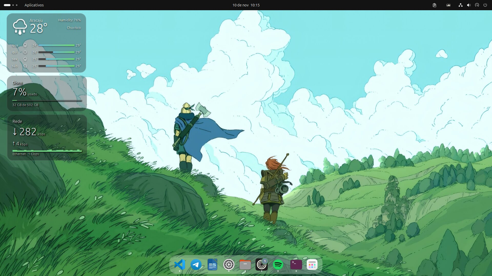
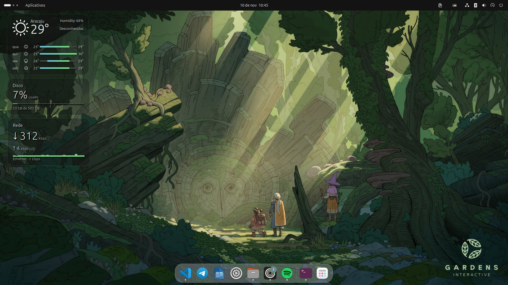
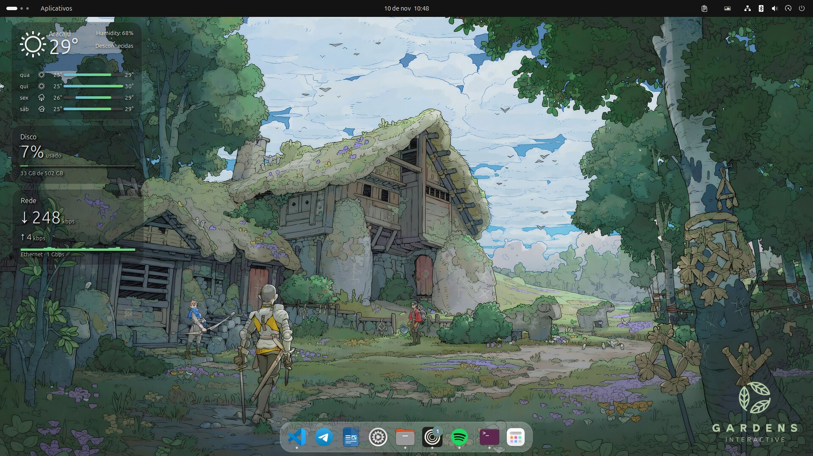

<h1 align="center">dotfiles-ubuntu</h1>

<p align="center">
  Minha personalização do Ubuntu (GNOME), pronta para reaplicar numa máquina nova com um comando.
</p>

<p align="center">
  
  
  
</p>

<p align="center">
  
</p>

---

## Galeria

O Variety troca o wallpaper a cada 20 minutos; os widgets ficam sempre por cima.

<table>
  <tr>
    <td></td>
    <td></td>
  </tr>
</table>

## Sumário

- [Galeria](#galeria)
- [Instalação](#instalação)
- [O que vem no pacote](#o-que-vem-no-pacote)
- [Atalhos de teclado](#atalhos-de-teclado)
- [Atualizar o pacote](#atualizar-o-pacote)
- [Observações](#observações)
- [Estrutura do repositório](#estrutura-do-repositório)
- [Créditos](#créditos)

## Instalação

```bash
sudo apt install -y git
git clone https://github.com/MEUCAPSQUEBROU/dotfiles-ubuntu.git ~/dotfiles-ubuntu
cd ~/dotfiles-ubuntu
./instalar.sh
```

No fim, **faça logout e login** para o GNOME carregar o tema, as extensões e os widgets.

| Comando | O que faz |
|---|---|
| `./instalar.sh` | Visual + apps, e pergunta se instala o ambiente de dev |
| `./instalar.sh --tudo` | Visual + apps + ambiente de dev |
| `./instalar.sh --sem-dev` | Só visual + apps |
| `bash scripts/dev.sh` | Só o ambiente de dev |

Pode rodar de novo sem medo: o que já está instalado é pulado.

## O que vem no pacote

### Visual

| | |
|---|---|
| **Tema** | [MacTahoe](https://github.com/vinceliuice/MacTahoe-gtk-theme) Dark grey (GTK 3, GTK 4/libadwaita e shell), modo escuro, destaque *slate* |
| **Ícones** | Yaru-white-dark (Yaru escuro com pastas brancas) + pacote MacTahoe |
| **Dock** | Embaixo, transparente, some quando uma janela encosta, sem lixeira e sem discos |
| **Janelas** | Botões minimizar, maximizar e fechar; organização em grade com Tiling Assistant |
| **Wallpapers** | 39 imagens trocadas pelo Variety a cada 20 minutos |

### Widgets na área de trabalho

Feitos com a extensão Desktop Widgets (azclock), com ajustes próprios:

- **Clima** com previsão de 4 dias
- **Disco**: uso da partição principal, com barra que muda de cor
- **Rede**: velocidade de download e upload, com histórico
- **Relógio grande** e **chuva estilo Matrix** (configurados, desativados por padrão; ative em *Extensões → Desktop Widgets*)

### Extensões

Desktop Widgets (azclock) · Clipboard Indicator · Tiling Assistant · User Themes · Ubuntu Dock · AppIndicators · Desktop Icons

### Apps

| App | Detalhe |
|---|---|
| Spotify | Com [Spicetify](https://spicetify.app) + Marketplace |
| Zen Browser | Instalado em `~/.local/opt/zen` |
| VS Code | Tema Dark+ Pure Black (OLED), Material Icons, atalhos e extensões |
| Ptyxis | Terminal com paleta Linux |
| Telegram, Postman, Chromium | Via snap |

### Ambiente de desenvolvimento

`scripts/dev.sh`: Docker Engine + Desktop, SDKMAN com Java 21/17 (Temurin), NVM com Node LTS/20/22, PostgreSQL, pgAdmin/DBeaver, opencode, VS Code e IntelliJ IDEA Community. Funciona em rede com proxy.

## Atalhos de teclado

| Atalho | Ação |
|---|---|
| <kbd>Super</kbd> + <kbd>S</kbd> | Print de uma área, direto para a área de transferência |
| <kbd>Super</kbd> + <kbd>Shift</kbd> + <kbd>S</kbd> | Print da tela inteira, direto para a área de transferência |
| <kbd>Print</kbd> | Ferramenta de captura do GNOME |
| <kbd>Shift</kbd> + <kbd>Print</kbd> | Print da tela inteira, salvo em *Imagens/Capturas de tela* |
| <kbd>Super</kbd> + <kbd>V</kbd> | Histórico da área de transferência |
| <kbd>Super</kbd> + <kbd>E</kbd> | Abre a pasta pessoal |
| <kbd>Super</kbd> + <kbd>M</kbd> | Central de notificações |

Para capturar menus e a Visão geral (que fecham quando se aperta uma tecla de print), use o terminal:

```bash
print-atrasado      # espera 5 s, abra o menu; salva em Imagens/Capturas de tela
print-atrasado 10   # espera 10 s
```

## Atualizar o pacote

Mudou algo no visual? Exporte e envie:

```bash
cd ~/dotfiles-ubuntu
./exportar.sh                 # copia as configs atuais para o repo
./exportar.sh --wallpapers    # idem, e reenvia os wallpapers para o Release
git add -A && git commit -m "Atualiza configurações" && git push
```

## Observações

- **Rede com proxy autenticado**: o widget de clima precisa de um proxy local. Coloque o endereço em `~/.config/azclock/weather-proxy` (ex.: `http://127.0.0.1:3129`). Sem esse arquivo, ele usa a rede normal.
- **Widget de rede**: detecta a placa de rede sozinho. Para forçar uma, defina `NET_IFACE`.
- **Tema do Spotify**: o tema escolhido no Marketplace fica salvo no próprio Spotify. Numa máquina nova, escolha de novo em *Marketplace → Themes*.
- **Cidade do clima e posição dos widgets**: ficam em `gnome/dconf/shell.ini`.
- **Wallpapers**: ficam no Release [`wallpapers`](https://github.com/MEUCAPSQUEBROU/dotfiles-ubuntu/releases/tag/wallpapers), não no git, para o repo continuar leve.

## Estrutura do repositório

```
.
├── instalar.sh          instala tudo
├── exportar.sh          copia a configuração atual da máquina para o repo
├── scripts/
│   └── dev.sh           ambiente de desenvolvimento
├── gnome/
│   ├── dconf/           configurações do GNOME, uma por área
│   └── extensions/      extensões instaladas pelo usuário
├── icons/               ícones Yaru-white-dark
├── bin/                 scripts dos widgets e do print
├── config/              Variety, Spicetify, Zen, VS Code, chave do repo do Spotify
└── docs/                imagens deste README
```

## Créditos

- [MacTahoe GTK theme](https://github.com/vinceliuice/MacTahoe-gtk-theme) e [MacTahoe icon theme](https://github.com/vinceliuice/MacTahoe-icon-theme), de vinceliuice
- [Desktop Widgets (azclock)](https://gitlab.com/AndrewZaech/azclock), GPL-3.0, com ajustes locais
- [Clipboard Indicator](https://github.com/Tudmotu/gnome-shell-extension-clipboard-indicator)
- [Spicetify](https://spicetify.app)
- Wallpapers: [wallhaven.cc](https://wallhaven.cc)
